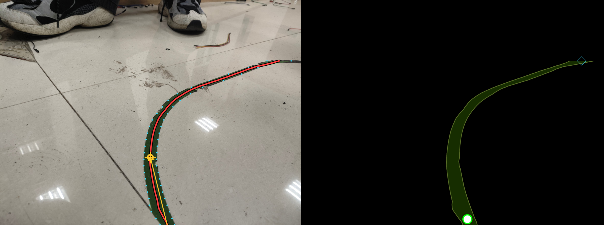
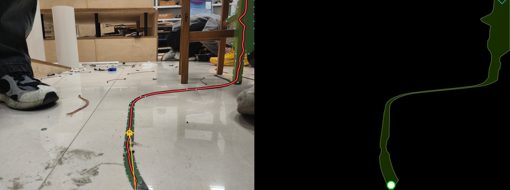

# 基于 OpenCV 的巡线（Line Following）

从地面**黑色胶带**画面里提取中心线，实时给出可行驶走廊、横向偏差和航向角。
程序同时打开两个窗口：

| 窗口 | 内容 |
| --- | --- |
| `Original + Detection` | 原图 + 识别叠加：绿色走廊、红色中心线、青色左右边缘、橙色前瞻点、左上角 HUD |
| `Path on Black` | **纯黑画布**，只把识别到的路径画出来（发光中心线 + 左右轨道 + 起点/前瞻点/终点） |

三张现场照片的实测结果（左：原图叠加，右：纯黑画布）：




## 目录结构

```
line_follower/
├── run.py                  # 命令行入口
├── requirements.txt
├── linefollow/
│   ├── config.py           # 所有可调参数，集中在一处
│   ├── detector.py         # 阈值分割 + 扫描线追踪 + 中心线后处理
│   ├── overlay.py          # 两个窗口的绘制
│   └── app.py              # 主循环 / 输入源 / 键盘交互
├── tools/
│   ├── preview.py          # 无窗口批量导出预览图
│   ├── selftest.py         # 自检：三张样图 + 空白/全黑反例
│   └── fetch_wheel.py      # 断点续传下载 wheel（网络不稳时用）
├── samples/                # 三张现场照片
└── out/                    # 结果输出
```

## 安装

本目录下的 `.venv` 已经装好 `opencv-python 4.13` 和 `numpy 2.3`，可以**直接运行**。
换机器时：

```bash
python -m venv .venv
.venv\Scripts\activate          # Windows
pip install -r requirements.txt
```

## 运行

```bash
# 单张图片 —— 打开两个窗口，按 q 退出
.venv\Scripts\python.exe run.py --image samples/sample1.jpg

# 视频（按原帧率播放）
.venv\Scripts\python.exe run.py --video track.mp4

# 摄像头（默认 0 号）
.venv\Scripts\python.exe run.py --camera 0

# 只算不开窗口，把两幅画面存到 out/cli/
.venv\Scripts\python.exe run.py --image samples/sample1.jpg --save --no-gui

# 现场调参：窗口里出现 thresh / min_w / max_w 三个滑条，拖动实时生效
.venv\Scripts\python.exe run.py --camera 0 --tune

# 自检（不开窗口，检查环境 & 三张样图）
.venv\Scripts\python.exe tools\selftest.py
```

按键：`q` / `Esc` 退出，`s` 保存当前两幅画面到 `out/`，`空格` 暂停/继续（视频）。

常用参数：

| 参数 | 默认 | 说明 |
| --- | --- | --- |
| `--proc-width` | 960 | 处理分辨率宽度，`0` = 原图 |
| `--thresh` | 85 | 黑色阈值，灰度 < 该值算黑线 |
| `--adaptive` | 关 | 叠加自适应阈值，光照不均时打开 |
| `--lookahead` | 0.30 | 前瞻点位置（距图像底部占图高的比例） |
| `--tune` | 关 | 显示调参滑条 |
| `--save` / `--save-dir` | 关 / `out` | 保存结果 |

## 算法流程

1. **缩放 + 灰度 + 模糊**：统一到 `proc_width`，高斯模糊压掉地砖高光与噪点。
2. **黑色分割**：`gray < black_thresh` 取反；可选叠加 `adaptiveThreshold`（"既绝对够黑、又比邻域暗"）。
3. **形态学**：开运算去掉螺丝、碎屑等小黑点；闭运算把胶带磨损造成的断口接上。
4. **扫描线追踪（核心）**
   从图像底部逐行向上扫，每行取宽度落在 `[min_line_width, max_line_width]` 之间的黑色连通段；
   以上一行中心点为基准，只在 `max_jump` 范围内挑最近的那一段。
   → 鞋子、桌腿这类大黑块因为**太宽**被丢掉，零碎黑点因为**跳变太大**被丢掉，
   得到的路径一定是连续的一条。
5. **后处理**：断口线性插值 → 按 `y` 重采样 → 中心线/边缘滑窗平均。
6. **输出量**：
   * `offset_px`：前瞻点相对画面中线的横向偏差（px），`offset_ratio` 是归一化值 `-1..+1`；
   * `heading_deg`：车头（路径底端点）指向前瞻点的偏角，右正左负；
   * `confidence`：路径有效跨度 / (0.75×图高)，用来判断是否丢线。

在 2363×1774 的输入、`proc_width=960` 下，单帧约 **16~19 ms**（≈55 FPS，纯 Python/OpenCV）。

## 接到底盘控制

```python
det = detector.detect(frame)
if not det.valid:
    robot.stop()                                     # 丢线
else:
    err = det.offset_ratio                           # -1..+1
    steer = Kp * err + Kd * det.heading_deg          # 增益自己调
    robot.drive(base_speed, steer)
```

## 调参速查

| 参数 | 说明 |
| --- | --- |
| `black_thresh` | 胶带漏检 → 调大；地板/阴影被误检 → 调小 |
| `min/max_line_width` | 按胶带在画面里的像素宽度设，`max` 也是挡鞋子的关键 |
| `max_jump_ratio` | 线走得越"横"，越要调大 |
| `max_gap_ratio` | 允许的断线长度，胶带磨得厉害就调大 |
| `close_ksize` | 胶带磨得越花，调得越大（奇数） |
| `lookahead_ratio` | 前瞻点高度，越大越"看远" |
| `smooth_window` | 中心线平滑窗口，抖动大就调大（奇数） |

## 已知边界

* **反光**：地砖高光会被判成"不黑"，闭运算能补一部分；仍不行就开 `--adaptive`。
* **胶带磨损**：磨成灰白时把 `close_ksize` 调到 9~15。
* **鞋子入镜**：靠 `max_line_width` + 连续性约束排除，不需要额外目标检测。
* **接近水平的线段**：扫描线是按行找的，胶带如果拐到几乎水平（画面里那一行会切出很长的黑段，
  超过 `max_line_width`），路径会在拐角处截止——这正好是机器人该打方向盘的位置。
  样例 `sample3` 就是这种情况，`conf=0.73`。
* **相机固定**：`offset_px` 才有可比性；改安装高度后要重新调阈值和宽度范围。

## 网络不稳时怎么装 opencv

`tools/fetch_wheel.py` 用 HTTP Range 分块 + 无限重试把 wheel 拉下来，断点续传：

```bash
.venv\Scripts\python.exe -u tools\fetch_wheel.py <wheel直链> _wheels\opencv.whl
.venv\Scripts\python.exe -m pip install --no-index --no-deps _wheels\opencv.whl
```

（wheel 文件名要符合 `opencv_python-4.13.0.92-cp37-abi3-win_amd64.whl` 这种格式，
下载完记得先改名再用 pip 安装。）
